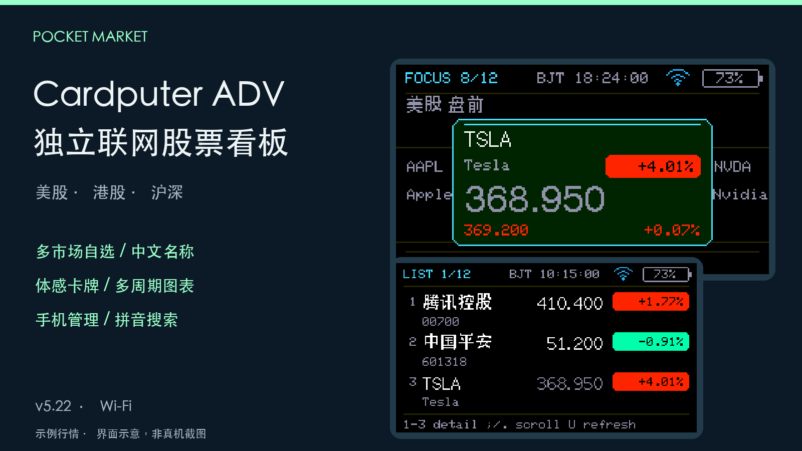

# Pocket Market · Cardputer ADV 股票看板

把 Cardputer ADV 变成独立联网的股票信息小屏。支持美股、港股、沪深股票以及数据源支持的 ETF / 指数；提供三行自选、体感卡牌、多周期图表、拼音搜索和手机自选管理。

当前版本 **v5.22**。仅面向 **Cardputer ADV / ESP32-S3 / 8MB Flash / 240×135**；其他硬件未验证。

## 能做什么

- **混合自选**：A 股、港股中文名在上、代码在下；美股代码在上、公司简称在下。价格保留三位小数，涨红跌绿，涨跌幅底色配黑字。
- **普通列表**：每屏三只，1 / 2 / 3 进入对应详情。上下短按滚动，长按加速，首尾可循环，并有短暂边界提示。自选没有固定十只上限，实际受内存和存储空间限制。
- **体感卡牌（motion 版）**：G 开关，左右倾斜滑卡，中央卡牌放大；左右按键微调，长按连续滑动。平放 / 竖放静止止漂，Enter 打开选中股票，ESC 回到普通列表。
- **美股盘前**：盘前同时查看最近常规收盘价与盘前价格 / 涨跌幅。开盘后隐藏盘前行，只显示常规报价。盘后 / 夜盘 / 休市仅显示最近常规报价，不提供夜盘或盘后价格。A 股、港股使用一组常规价格，午休保留当日最后报价。
- **图表**：5 日、日 K、周 K、月 K、年 K；TAB 切换周期，空格切线图 / 蜡烛图，Z / X 缩放。5 日固定线图；历史来源不可用时可能回退到标明 `5 closes` 的五个收盘点。
- **搜索添加**：F 打开搜索。支持代码、名称；内置股票常用词拼音候选，以及 50 只常用股票的中文、全拼、首字母与英文别名。未命中本地索引再在线查询。词库并非全市场离线目录。
- **手机管理**：W 显示本地网页二维码，手机同一 Wi-Fi 扫码即可批量添加、拖动排序、删除并保存自选。底部保存状态始终可见。设备无相机，扫码由手机完成。
- **自动与手动刷新**：自动刷新间隔可选；U 和侧键手动刷新。列表与卡牌共用缓存，空闲时后台预加载相邻及其他股票和美股盘前报价。内存不足时跳过预加载，图表仍按需加载。
- **基础设置**：离线 Wi-Fi 扫描（中文名称、同名去重、信号排序与强度显示、隐藏网络入口）、亮度、B 关 / 亮屏、顶部所在地时钟、Wi-Fi 状态、电量估算。时区手动选择并保存，默认北京时间，不做自动定位。
- **精简状态**：交易 / 竞价时主价亮色，非交易时灰色；异常橙点提示交易时旧价、延迟、时间无效或盘前抓取异常。盘前成交较早本身不再触发橙点。详情 / 卡牌保留当前股票市场状态。

## 安装与开始使用

完整步骤见 [安装与首次使用](docs/安装与首次使用.md)。

| 文件 | 地址 | 用途 |
| --- | --- | --- |
| [含体感完整安装](https://github.com/panpanweijie/cardputer-adv-pocket-market/raw/refs/heads/main/firmware/pocket-market-v5.22-motion-full-0x0.bin) | **0x0** | 首次完整安装，含体感；会覆盖配置区域 |
| [标准版完整安装](https://github.com/panpanweijie/cardputer-adv-pocket-market/raw/refs/heads/main/firmware/pocket-market-v5.22-standard-full-0x0.bin) | **0x0** | 首次完整安装，不含体感 |
| [含体感保留配置升级](https://github.com/panpanweijie/cardputer-adv-pocket-market/raw/refs/heads/main/firmware/pocket-market-v5.22-motion-update-0x10000.bin) | **0x10000** | 已使用本项目相同分区的升级，保留配置，不擦除 Flash |
| [标准版保留配置升级](https://github.com/panpanweijie/cardputer-adv-pocket-market/raw/refs/heads/main/firmware/pocket-market-v5.22-standard-update-0x10000.bin) | **0x10000** | 去除体感，其余功能相同；同布局升级 |

源码与固件：[GitHub](https://github.com/panpanweijie/cardputer-adv-pocket-market)。

M5Burner 网页入口：[Cardputer ADV](https://burner.m5stack.com/device/cardputer-adv)。本交付尚未上架；上架后可在该分类搜索 **Pocket Market**。本地也可用 [Espressif Web Flasher](https://espressif.github.io/esptool-js/) 按表中地址写入。不要把 full 与 update 的地址混用。

首次开机：TAB → Wi-Fi → Enter 扫描 → 选择网络 → Enter 输入密码 → Enter 连接。再按 F 搜索或 W 用手机管理自选。初始列表是公共演示列表，可以替换。

## 全部按键与操作

[完整按键表](docs/全部按键.md) · [手机管理与搜索](docs/手机管理与搜索.md) · [数据与市场规则](docs/数据与市场规则.md) · [构建说明](docs/构建说明.md) · [发布验证](docs/发布验证.md)

## 版本选择

motion 包含实验性 IMU 卡牌模式；standard 移除体感入口，其余功能保留。体感手感、网络可达性和长时间运行效果受设备与网络影响。两种公开固件已完成编译、镜像校验和包内容检查，公开整包的全新设备烧录及持续运行尚未完整验收；不把构建通过视为硬件验收。

## 数据与边界

报价 / 搜索主要使用腾讯公开接口，历史图表带备用来源。免费数据可能延迟、缺失或访问失败；不承诺逐笔实时，没有下单功能。行情故障时可按 U 重试；图表无数据时显示 `Press U to refresh`。

Wi-Fi 图标蓝色表示已连接路由器，红色表示未连接，不代表数据源一定可用。电量是 ADC 估算，不是精密电量计。B 只关闭显示，设备仍工作联网。

## 来源与许可

基于 [ansonlianson/cardputer-adv-stock-monitor](https://github.com/ansonlianson/cardputer-adv-stock-monitor) 修改，保留原 MIT 许可，见 [LICENSE](LICENSE)。依赖包含 M5Cardputer、M5Unified、M5GFX、ArduinoJson 与 Arduino ESP32，各自遵循对应许可。GitHub 账号：[panpanweijie](https://github.com/panpanweijie)。

前五张功能配图为界面示意；第六张使用用户 ADV 实拍与项目真实网页截图，网页填充公共示例自选，二维码及局域网地址已模糊。

## Wi-Fi 与功耗（v5.22）

网络名支持中文，按信号排序、同名去重，右侧显示 dBm（-45 比 -75 强）。隐藏网络会明确标注，选中后先输入名称，再输入密码。仅支持 2.4GHz，纯 5GHz 网络不会出现。R 手动重扫；扫描中不重复启动。

已连接时不主动断网扫描，离线时暂停尚未完成的连接尝试；正常一轮，失败最多重试一次。退出扫描恢复原连接与省电策略。本版修复 Arduino Wi-Fi 扫描结构未完整初始化的问题，源码必须保留 `lib/WiFi`，详见 [修复记录](lib/WiFi/LOCAL_PATCH.md)。该库保留 LGPL-2.1-or-later 许可，其余本项目代码保留原 MIT 许可。

减少主循环空转；时钟每秒仅传输自身区域；关屏不传输画布；非当前股票后台预载间隔至少 60 秒。当前报价刷新、亮度和体感动画保留原设置。B 仍只关屏，不是深度休眠。续航提升未做定量测量。

## 界面状态速查

| 显示 | 含义 |
| --- | --- |
| 主价格亮色 | 当前股票市场处于交易 / 竞价时段 |
| 主价格灰色 | 非交易时段，保留最近常规报价；不等于报价损坏 |
| 黄 / 橙点 | 报价旧、延迟、时间无效或盘前抓取异常；盘前长期无新成交本身不触发 |
| Wi-Fi 蓝色 | 已连接路由器，不能据此保证行情服务正常 |
| Wi-Fi 红色斜线 | 未连接路由器 |
| 电池百分比 | 电压估算，不能当作精确电量计 |

## 功能图

[更多功能与操作图](docs/功能图.md)
